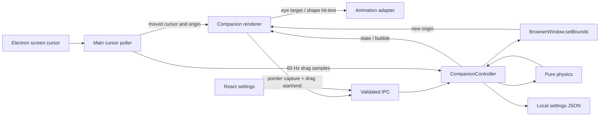

# Ducky architecture (Milestones 1–3 and Expansion Phases A–C)

## Milestone 6: ambient cadence and optional observation pipeline

The single timing table is src/core/dialogue/cadence.ts. Personality/emotion scales
thought intervals inside the requested bounds. Won't shut up uses the existing
2-second behaviour tick to choose a thought, mood mutter or small activity line,
with app/title follow-ups at their own bounded intervals. Accepted ambient AI
silence/errors use the already selected authored line; screen observations have
no fallback. Director templates and AI similarity checks both retain 30 lines.
Existing interaction memories and task thoughts remain available.

TitleActivity owns one safe summary, dwell thresholds and two minutes of app
transitions. AppAwareness runs one hidden resident PowerShell/C# helper. It omits
GetWindowTextW entirely unless title or effective screen permission is enabled;
process/self/user exclusions run before title reads, and private-site filtering
runs before stdout. Base64 only frames UTF-8 titles over the pipe; main sanitizes
them immediately. The sample command wakes an AutoResetEvent instead of launching
a second helper or adding a polling loop. Privacy/DND/focus/conversation use the
identity-free geometry variant. No title or HWND is published in CompanionState.

ScreenAwareness is driven by existing ticks, with a debounced change deadline and
a periodic deadline. Successful delivery establishes the unchanged-frame baseline; cold/failed observations can retry at the next scheduled sample. It has a single in-flight lock, abort/epoch checks, and a
640-byte grayscale hash. Fresh permitted foreground samples surround a resident
helper `capture <hwnd> <maxW> <maxH>` request. The helper rechecks the exact HWND,
foreground/minimized/fullscreen state, own processes and private exe/title filters
before `PrintWindow` renders that one window. JPEG encoding and aspect-preserving
downscaling happen in memory, with a 400 KB output cap; no window enumeration or
desktop fallback exists. Main decodes the JPEG for a 32×20 hash and blank-frame
rejection. Timeout retires the helper pipe to prevent stale reply association.
See privacy.md for foreground-switch races and capture lifetime.

Capture -> fixed vision prompt + JPEG -> structured neutral description ->
HybridBrain prompt with permitted app/title + character state -> existing JSON,
content, observation-leak and repetition validation -> SpeechQueue -> bubble.

The image is released after its request; the description exists only for this
pipeline. There is no path from either to conversation, settings or memory stores.
An eight-second deadline includes capture and both requests. Privacy/permission,
mode, window/title changes and user silence abort or invalidate in-flight work.
Only the main process's fixed-loopback provider performs requests. No renderer
network access, new dependency, capture timer when off, or vision-driven movement.
The eye badge consumes permission/capture-revision metadata only; it and the tray
stop label use the existing validated settings IPC to revoke screen permission.


## Expansion Phase B: productivity

`core/productivity/parse.ts` uses the already installed chrono-node 2.10.3. It runs
before Phase A memory intents and model inference, with numbered title choices
and a pending “When?” continuation in `main/productivity/service.ts`. Ideas and
notes route to notes rather than approved long-term memory. Relative dates, next
ambiguous AM/PM occurrences and local calendar dates are deterministic under an
injected parser reference date. Explicit recurring requests without a time use
9am, which is shown on the confirmation card.

`main/productivity/store.ts` owns tasks.json, reminders.json, notes.json and
focus.json under userData. Each is `{version:1,data:...}` with validation, bounded
lists and string lengths. Store snapshots are cloned. Mutations are serialized;
the 250ms debounce resolves its promises only after temp-file write, fsync and
atomic rename succeed. Only then do cards, acknowledgements and celebrations
publish. Failed writes retain the last committed in-memory state. Corrupt files
are copied to timestamped `.corrupt-*` backups before starting empty; a visible
message reports recovery. Shutdown flushes pending writes. These stores are
separate from all memory/retention/Forget everything paths.

`core/scheduler` is Electron-free and takes wall and monotonic clocks. Main checks
every 15 seconds, at startup and on powerMonitor resume/unlock-screen. It compares
elapsed clocks for jumps over two minutes and checks the system timezone on each
tick. Dates advance with local calendar setters, retaining an original wall-time
anchor across DST gaps. Monthly 31 clamps to the last day; custom intervals keep
their original calendar-day phase. Timezone changes translate old-zone wall time
to the new system-local zone. A passed recurring schedule produces one delivery
and advances directly to a future occurrence, not one delivery per missed day.

Before presentation, the scheduler durably commits `state:due`, `lastFiredAt`
(the delivered occurrence's timestamp, also the idempotence marker), clears a
fired snooze, and advances recurring `at`. A crash after this write but before
presentation leaves an outstanding due card recoverable on startup; it does not
repeat the alarm/OS notification. Done/Dismiss acknowledge the occurrence;
recurring reminders remain scheduled. Cancel deletes the reminder after
confirmation. A single queue and one card expose a waiting count. New deliveries
bypass ordinary speech mute/talkativeness. Phase C wires the DND/gaming hooks to
notification-only delivery or the chosen reminder exception. Notification clicks
open the relevant card.
There is **no OS-level scheduling**: reminders only fire while Ducky is running.

The Phase A registry exposes task/reminder/note/focus tools; its live names now
also populate the constrained model JSON schema. Destructive tools have `confirm`
permission. Conversation uses authored yes/no prompts; cards/settings receive
single-use, action-bound, 60-second main-process confirmation tokens. A renderer
cannot supply a `confirmed` boolean. Failed tools bypass model prose and successful
mutations use authoritative tool acknowledgements. The existing trusted-frame IPC
checks protect the explicit productivity and reading-save preload methods.

`renderer/companion/productivity.ts` uses only DOM text/value nodes for data. It
shares the Phase A upward/sideways clamped layout and foot anchor, with a card
maximum of 420 DIP in each dimension (current layout requests 360 high). Native
buttons and fields support Tab/Enter/Space; capture-phase Escape closes a card
before ending conversation. Cards hold movement still and suppress ambient
interruptions; they do not create a second window. A reminder turns Ducky toward
the centre side without walking. Save/Pin store a reading reply as one saved note.

Focus uses one deadline timeout only while running and a one-second countdown
only in the active renderer badge. Pause clears both. Sessions and the four-focus
break counter are in RAM; focus.json keeps defaults and opt-in completed-session
history (bounded to 1000). History defaults off and disabling it erases entries.
Focus suppresses ambient activity/speech/app comments, while reminders continue.
Breaks can be offered or auto-started. Alarm/celebrate are finite placeholder
clips; focus is a static laptop pose. Native CPU and desktop behavior await Claude.

## Expansion Phase A: conversation flow

`main/conversation/controller.ts` owns lifecycle, focus, shortcut registration,
local commands and presentation. `engine.ts` owns serialized generation, aborts,
deadlines, output validation and tool rounds. `core/conversation/` contains
Electron-free intent parsing, pronoun conversion, keyword/recency retrieval,
retention, presentation, schema validation and window layout. Retrieval implements
`MemoryRetrieval`, replaceable with embeddings later.

```text
Double-click / globalShortcut / tray Talk to Ducky
  -> synchronously setFocusable(true), show, focus, webContents.focus (no await)
  -> suspend activities, movement and ambient AI -> focus-confirmed attached textarea
Enter -> validated companion-only IPC -> cancel old generation -> local parser
  -> local command -> atomic operation -> authored acknowledgement
  -> other text -> preset + honesty + date/time + preferred name
                  + last 12 messages + 8 memories + 3 summaries
     -> MAIN Ollama /api/chat -> JSON validation -> tone -> adapter state
     -> optional tool registry -> permissions -> actual tool result -> finalization
     -> current reply only -> timed beats OR safe DOM reading panel
Escape / bye / 20s blur / 90s no input / hide / pause
  -> abort inference -> setFocusable(false) -> hide -> showInactive -> reapply topmost
  -> retain conversation if allowed -> small summary request
  -> optional authored sign-off -> resume previous activity
```

Conversation options: temperature 0.8, num_predict 700, 45-second request deadline,
stream:false, think:false and JSON format. Summary requests use 200 predicted tokens.
At eight seconds an ordinary pending reply shows one authored thinking line.
New input/close invalidate stale results even with a non-cooperative fake provider.
Ambient AI remains suspended through summarization after the visible conversation
ends. All transport still uses the fixed 127.0.0.1 origin with redirects denied.
Renderer/core make no requests. There is no cloud fallback or new dependency.

Immediate prompts keep the last 12 user/assistant messages. Active sessions retain
at most 200 messages for the optional archive and drop RAM context on close.
Retrieval ranks exact keyword overlap above recency, returning at most eight
memories and three summaries. It never ingests app awareness. Offline archives get
up to six keywords from user text. A summary request uses the last 24 messages;
failure/cancellation preserves those fallback topics. Archives cap at 500 sessions;
explicit memories cap at 1,000 records.

The registry defines safe, confirm and blocked permissions. Recall tools are safe.
Model-proposed remember/forget requires a subsequent exact yes. No cancels, and
unrelated input drops pending confirmation. Explicit local remember/forget commands
already express authorization. Argument validation, a two-execution-round cap and
failure handling are authored code. Actual results go back to the model. Failed
operations bypass model prose; successful mutation acknowledgements use the actual
operation result. A guard rejects obvious unverified external-action claims from
tool-free replies. Model output is never evaluated or passed to a shell.

Window expansion unions the original duck rectangle with a response surface,
clamped to the display work area. Renderer receives explicit character and content
offsets so the foot anchor stays fixed. Movement stops during conversation;
display/size recovery ends it. Only the adapter inspects/mutates SVG. Markdown uses
text nodes and an allowlisted AST: no raw HTML, images or link interpretation.
Transcript views exist only in the Settings archive.

New IPC is allowlisted and strictly validated. Send/end/typing/panel/copy require
the companion main frame; library mutations require the Settings main frame.
Export accepts an archive ID and opens a native save dialog, never a renderer path.
Focus activation runs synchronously inside the hotkey or double-click IPC path,
before any async work. The state publication asks the renderer to focus the input
only when `isFocused()` confirms activation. After 300 ms without focus, one retry
uses `setAlwaysOnTop(true, 'screen-saver')`, `moveTop()`, `focus()` and
`webContents.focus()`. A final check 300 ms later restores the topmost preference.
Failure leaves the input hidden/disabled and the bubble saying "Click me to type."
A duck/bubble click retries activation legitimately. Blur also hides the input.
On close, `setFocusable(false)`, `hide()` and `showInactive()` run consecutively,
then reapply the user's always-on-top/desktop-only preference. Windows chooses the
next foreground window in z-order, normally the previously used app. There is no
PowerShell focus helper or captured native handle. Desktop activation still needs
verification against a real foreground application; fake-window tests verify order.

`core/content-safety` checks every model output string, including ambient second
beats, tool arguments and summary topics, independently of the profanity toggle.
It normalizes common leetspeak/invisible variants and blocks slurs, sexual words,
self-harm encouragement and directed/short insults. A blocked conversation reply
is discarded and regenerated once with "your last reply contained a disallowed
word"; a second rejection returns an authored `talk_error` line. Ambient output
falls back to the authored line; unsafe summaries retain user-derived topics.
This deterministic blocklist is conservative and is not a semantic classifier.
User input with fewer than two visible graphemes or no letters receives an authored
`talk_huh` line without reply inference. Numeric memory-choice commands still work
locally. The set contains four short clarification lines.

Listening/thinking CSS loops exist only during conversation. Beat timers clear
on interruption/exit; the extra retention interval runs daily. Quit unregisters
the shortcut and cancels timers/requests. Native idle CPU still needs measurement.

The remaining sections describe the M1–M3 foundations. Their old double-click
behavior is superseded: double-click now talks; Settings remains in native menus.

The main process owns all position, movement, behaviour and persistent state.
The sandboxed renderer presents that state. Pure TypeScript core modules have no
Electron imports and are tested with synthetic clocks, RNGs and display layouts.

## Modules and process boundaries

| Module | Responsibility |
| --- | --- |
| `src/main/index.ts` | Single-instance lock, lifecycle, window/tray wiring, display and resume listeners, clean shutdown |
| `src/main/windows` | Companion/settings creation, navigation and popup denial, session permission/network boundaries |
| `src/main/platform` | Electron display work areas in DIP; cursor poller |
| `src/main/companion/CompanionController.ts` | Authoritative body, active timers, interaction interpretation, event reactions, `setBounds`, speech presentation |
| `src/main/settings` | Validated JSON load, 750 ms debounce, synchronous temp-write/rename, final flush |
| `src/main/memory` | Validated bounded interaction memory, atomic debounce, disable/forget deletion |
| `src/main/ipc` | Named channel allowlist, sender/frame/page checks, strict payload validation, role restrictions |
| `src/main/tray` | Hand-drawn 32 px bitmap converted to PNG, dynamic native menus |
| `src/preload/index.ts` | Typed `window.ducky`, explicit methods and removable subscriptions; no raw IPC or Node exposure |
| `src/renderer/companion` | Adapter host, shape-based hit decisions, pointer capture, bubble presentation |
| `src/renderer/settings` | React controls and live settings; normal focused window |
| `src/core/physics` | Gravity, friction, bounded throws, two-bounce cap, safe display selection, walking and recovery |
| `src/core/behaviour` | Mood/emotion-weighted activities, rare-event cooldowns, injectable clock and RNG |
| `src/core/emotions` | Seven numeric emotions, local daily mood, decay, daily patience and idle face |
| `src/core/memory` | Fixed interaction-only schema, sanitized names, rolling pickup aggregates and running jokes |
| `src/core/events` | Typed bus for all section-28 event names |
| `src/core/interruptions` | One visible speech slot, priority/cooldown/mute/block rules, no backlog |
| `src/core/dialogue` | Situation policies, weighted authored pools, last-twelve template exclusion, interaction context |
| `src/animation` | Replaceable adapter contract and self-contained SVG implementation; Rive README only |
| `src/shared` | Settings/IPC types, defaults, channel names and strict validators |
| `src/ai/providers` | Electron-free provider request/interface contracts |
| `src/ai/ollama` | Fixed loopback HTTP transport, schema, deadlines and aborts; instantiated only by main |
| `src/ai/prompts` | Allowlisted context, sanitized app names, same-situation examples and recent dialogue |
| `src/ai/response-validation` | JSON/shape, text, observation, profanity and repetition validation; enum defaults |
| `src/main/ai/HybridBrain.ts` | Model lifecycle, diagnostics, single-request ownership, hybrid routing and stale-result tokens |

## Window and coordinate model

The companion is one 320 × 300 DIP transparent window at size 1.0. The SVG occupies
the whole viewport, with the duck at the bottom and bubble room above. Size scales
both dimensions from 0.6 to 1.6. Physics coordinates are the window's bottom-centre:
`window.x = body.x - width / 2`, `window.y = body.y - height`.
Ground positions are floored to integer DIP. Final window x is rounded and y is
floored, so a fractional work-area floor cannot round the window into the taskbar.
Display scale factors are not applied a second time; Electron screen positions
and work areas already use DIP.

Bounds deliberately reserve space for the **whole window**, which is more
conservative than clamping just the duck's silhouette. Compatible adjacent
same-floor work areas form a walking corridor. Unequal floors cause walking to
turn around. An airborne duck can cross a seam in the displays' vertical overlap;
on reaching unequal ground, the nearest valid display is selected and the window
is fitted there before continuing the fall. This can cause a small positional
correction at a seam. Gaps are never treated as valid floors.

Dragging uses the nearest valid display/corridor and clamps there. Reset uses the
primary work area's bottom-right, with a 24 DIP margin. Startup retains a valid
saved position (falling if airborne), or resets if no display contains it. Display
addition/removal/metrics changes and resume recover to the nearest safe ground.

## Data flow



Cursor polling runs at 20 Hz within 600 DIP of the companion window or for one
second after movement, otherwise at 4 Hz. It sends only changed cursor positions,
preserving the last point across capture mode changes. During a candidate or
active drag, it samples at 60 Hz, including stationary samples to avoid stale
release velocity. Window movement has a separate origin-only notification, so
eyes and hit-tests remain correct even under a stationary cursor.

The renderer uses `document.elementFromPoint` **inside the adapter** against
painted SVG hit shapes, plus the visible bubble in its own HTML. Transparent
regions are not rectangular hitboxes. It sends hit-state changes to main, with
explicit resynchronization after capture/visibility transitions. While capture
is active, main keeps mouse input enabled. Forwarded mouse moves and cursor
updates allow hit-testing even when the window ignores clicks.

On pointer-down, the renderer captures the pointer and main records a grab offset.
Main stops walking immediately, then waits for four DIP of cursor movement before
entering picked-up state. Releases/capture loss/blur terminate the drag once. A
short velocity history feeds physics. Click reactions now run on the next timer
turn (no 500 ms debounce) to meet the instant-reaction target. Native double-click
still opens Settings; its first click may already have spoken.

## Timers and event handling

- Motion: 60 Hz only while falling, sliding or walking. Dragging uses the cursor timer instead.
- Cursor: adaptive 4/20 Hz while visible and unpaused; 60 Hz during capture; stopped otherwise.
- Behaviour: two-second tick while active; decisions are spaced 5–15 seconds apart.
- Idle: 30-second poll while active; threshold defaults to five minutes.
- Blink: one adapter timeout at a random 2–6 second interval, with occasional double blink.
- Breath: four discrete SVG poses spaced 400 ms apart, then eight seconds at rest;
  no ambient CSS animation or transition. Sleep letters stay static. Hide, pause,
  reduced motion and non-ambient poses cancel the breath timeout. Background
  throttling remains enabled; stationary idle has no 60 Hz animation/timer.
- Reactions and speech: bounded one-shot timers. Hide/pause clears them; the adapter stops its timers and CSS animation activity.
- Settings: 750 ms debounce; position changes are saved on release, settle, recovery and quit rather than each frame.

`EventBus` defines every brief section-28 event. M1 emits app start/resume, character
hover/click/pickup/drop/landing, user idle/return, and animation completion. The
controller subscribes to interaction/landing/idle events to drive reactions and
speech. App-awareness situations feed the same director. AI routing happens only
after its chance/cooldown decision and the interruption preflight accept speech.

The speech slot permits higher-priority speech to replace lower-priority speech;
equal/lower priority is rejected. There is no backlog. High priority bypasses
cooldown, but never pause/hide/sleep/top-edge suppression. Sustained dragging starts
a new interaction, interrupting pickup speech/cooldown before the director decides.

## Hybrid AI flow

```text
Interaction / ambient timer / permitted app sample (MAIN)
  -> invalidate older dialogue token
  -> DialogueDirector chance + situation cooldown + curated fallback selection
  -> SpeechQueue preflight (priority, mute, visibility, sleep, screen edge)
  -> rejected/silent: no AI call
  -> instant situation OR AI disabled/warming/error: show curated line immediately
  -> eligible slow situation and warm AI:
       allowlisted context + 4–6 same-situation examples + last 8 spoken beats
       -> MAIN fetch -> http://127.0.0.1:<numeric port>/api/chat
       -> 2.5-second deadline / cancellation / generation + situation recheck
       -> JSON and text validator, repetition against last 30 displayed beats
       -> shouldSpeak:false: authored fallback for scheduled ambient slots; otherwise silence
       -> invalid/error/timeout: curated fallback (only while still valid)
       -> valid: speech + allowed emotion/animation
       -> SpeechQueue recheck -> renderer bubble text / adapter

Settings -> validated IPC -> MAIN status/tags -> 60-second tiny warmup
  -> Connected / Warming up / Built-in fallback status -> Settings + tray
Test connection -> same serialized main provider -> validated sample in Settings
Pause/hide/sleep/privacy/AI disable -> abort transport + invalidate lifecycle token
New event/app switch/drag release/hover exit -> abort dialogue + invalidate token
```

The model never controls physics, event creation, cooldowns, priority or execution.
The renderer imports no AI transport and the CSP is unchanged. Warmup does not
block the event loop; ordinary events use built-in lines while loading. There is
no polling or automatic retry loop after errors: Test connection, changing the
model/settings, or resuming from suspension reconnects. Model keep-alive is ten
minutes; an unloaded model may hit the warm deadline on a later event and fall
back until reconnected. Optional AI follow-ups for instant reactions are omitted;
authored `then` and validated ambient AI `then` beats use the existing 1.5–2.5 s
replacement timing. Only actually displayed beats enter the bounded RAM history.

## Security boundary

Both renderers use context isolation, disabled Node integration, sandboxing and
web security. The preload builds to a single CommonJS file requiring only Electron.
Only static, validated channels are registered; output channels and unknown names
are not accepted as requests. Invocations verify the exact expected main frame,
webContents and page URL. Companion input methods are unavailable to the settings
renderer at the main-process boundary. Settings patches cannot write position or
the first-launch flag.

Windows block navigation, redirects, popups and webview attachment. The session
denies permissions and downloads. Production requests are limited to local
resources; development additionally permits the configured Vite loopback origin
and its WebSocket. Main's new network client is the fixed-origin Ollama provider;
it rejects redirects and never accepts a host/URL from settings, context or output.
The existing awareness helper runs a fixed authored PowerShell/C# script; model
output never reaches it. CSP denies inline scripts, objects, forms and arbitrary resource origins.
Inline styles are allowed for SVG/CSS adapter properties and React styles.

## Later milestones

| Milestone | Attachment point; not implemented in M1 |
| --- | --- |
| M2: brain | Implemented above; real-model quality and desktop responsiveness pending Claude |
| M3: personality | Implemented below; desktop voice, animation and CPU verification pending Claude |
| M4: awareness | Add separately permission-gated collectors under `src/awareness`; emit typed events without changing physics/renderers |
| M5: productivity | Implemented as Expansion Phase B above, using validated local JSON rather than SQLite |
| M6: vision | Add separately authorized selected-window capture under `src/awareness/vision`, transient data and validated AI context; no current capture permission or pipeline |
| M7: art | Replace `PlaceholderDuck` with the Rive implementation of the same adapter/surface contract |
| M8: release | Installer/signing, resource budgets, long-duration testing, crash recovery and security/accessibility review |

Productivity timers have their own lifetime: hiding the companion does not stop
reminders. Phase B supplies the task stores and reminder scheduler described above.
Opt-in awareness and local AI are implemented.

## Milestone 3 personality and memory flow

Main remains authoritative. Core has no Electron, filesystem, network or renderer
dependencies. Emotions and behaviour take clocks/RNGs; daily mood is a pure
date/install-seed/preset calculation. The authored presets file is unchanged.
A selection filter excludes guilt/directed-swearing beats and the existing AI
self-identification. Safe preset overlays win about 75% of fresh selections;
enabled profane overlays about 30%. Weighted bags are keyed by situation, preset
and pool, with one shared last-twelve template history. Exhausted small overlays
try the base pool before choosing silence.

Settings add personality (sarcastic), profanity (false), activityLevel (normal),
memoryEnabled (true), preferredName (sanitized, 30 characters), an internal random
installSeed, and dailyMood containing only date/mood. IPC cannot edit seed/mood.
Same-day preset changes do not reroll the mood.

`core/emotions` owns seven bounded values and mood baselines. Main ticks it every
30 seconds while visible/unpaused; sleeping freezes emotion changes. Resume
resets the elapsed-time anchor, preventing hidden/paused catch-up. Decay has a
ten-minute half-life. Boredom has a mild target capped at 55 and cannot reduce
happiness or raise irritation. Returns add happiness, never debt. Daily physical
interaction tolerance resets by local date; hover never raises it. Numeric
emotions stay in RAM. Main emits MOOD_CHANGED on startup/date rollover and sends
the resulting face through `adapter.setEmotion`.

`core/behaviour` weights ordinary activities by emotions and mood, with calm,
normal and lively intervals. Rare events have independent cooldowns. Visitors
average about one per active 24-hour day at normal level, not a guaranteed daily
visit; chaotic mood raises rare-event chances. Main holds finite activities with
one timeout. Sunglasses are a separate static accessory for about two minutes,
surviving ordinary pose changes. Physics still owns walking and positions.

Activities stop for pause/hide, drag, sleep, fullscreen or helper loss. Autonomous
behaviour waits for a known geometry sample. With app awareness off, the existing
helper runs in geometry-only mode: the generated script removes foreground
process identity queries and returns only an anonymous fullscreen bit. Fullscreen
entry cancels activities and autonomous walking. Its three-second sampling delay
means detection is not instantaneous. Helper failure suppresses autonomous work
until recovery; direct interactions remain available. There is no second helper.

`core/memory` validates a fixed schema and updates only direct Ducky interaction
aggregates. `main/memory/store.ts` owns memory.json, 750 ms debouncing, temporary
write/rename, dirty flush on quit, disable/forget deletion, and propagation of
deletion failures. Unchanged memory is not written every tick. A rolling seven-day
pickup histogram is pruned during active maintenance/restart. Settings receives
readable summaries. Forgetting clears the name in settings, RAM counters, pending
AI requests, recent AI context and diagnostic samples.

Memory greetings, pickup receipts and 7/30/100 run-day milestones use authored
templates and the usual speech gates. Anniversaries are attempted once per
accepted day in a session; restarting can attempt again because speech history
is not persisted. Disabling memory prevents memory dialogue/context and writes;
enabling starts fresh. Only the user's explicit name and one bounded fact (days
together) can enter AI memory context.

AI prompts include selected style, preset examples, profanity rule, mood and two
emotion words. Exact mild words are exempt only when enabled; strong language,
slurs and directed swearing remain rejected. Models cannot start rare events or
naps. Voice/privacy changes invalidate pending responses. Diagnostic samples use
the selected voice too.

Renderer work remains behind CharacterSurface. New activity CSS has finite
iteration counts; nap, sitting, signs and glasses are static. No new continuous
idle frame loop was added. Four-pose breathing and background throttling remain.
Native CPU/memory costs, including geometry-only mode, await Claude's measurement.

Development-only `electron . --debug-activity <id>` waits for a safe geometry
sample, then forces one allowlisted activity. Packaged builds ignore the flag;
there is no debug IPC endpoint. See animation-contract.md for IDs and durations.


## Expansion Phase C: modes, proactive flow and skill packs

`src/core/modes` owns one priority resolver:
`privacy > do_not_disturb > gaming > focus > conversation > companion`.
The displayed mode does not discard underlying flags: privacy plus DND still
blocks all AI and speech. DND is stored as 0 (off), -1 (indefinite), or an epoch
expiry; the existing behaviour tick expires it, even when manually hidden/paused.
Focus is the existing focus session (including paused focus); breaks retain the
existing quiet surface behaviour. The companion publishes mode, DND and gaming
state for tray, Settings, badges and both animation adapters.

Fullscreen samples use the existing geometry helper. A stateful hysteresis gate
requires 10 continuous seconds to enter and 5 seconds to leave; the existing
three-second samples/two-second tick quantize those transitions. App identity
collection is disabled during privacy, DND and gaming; geometry remains available
while gaming, including when the native window is automatically hidden. A native
hide event caused by gaming does not change the user's visibility preference.
The cursor/motion loops and renderer animations pause during gaming; the renderer
focus countdown stops until return. Only lightweight mode checks remain on the
behaviour tick; proactive evaluation/activities return early during gaming.
No new polling interval was introduced.

Flow on the existing slow behaviour tick:

1. Resolve mode and expire DND; reject blocked/hidden/paused/idle states.
2. `ProactiveScheduler` derives candidates from local tasks/reminders and permitted
   current app duration. Use local calendar dates; date-only tasks become overdue
   after their local day ends. Completed tasks are excluded from deadline/overdue work.
3. Respect feature settings, quiet hours, pack eligibility, candidate chance,
   once-per-day/per-deadline delivery markers, per-app backoff and attempt cooldown.
4. Ask `DialogueDirector` for the authored line with personality, mood and
   talkativeness. Its chance, per-situation cooldown and recent-line exclusion
   still apply. The rubber-duck offer can be used only once per application run.
5. Pass through `SpeechQueue`. Only accepted speech creates an action card and
   consumes a delivery marker. Rejected candidates back off for ten minutes;
   gaming comeback gets one chance within one minute, with no queued late return.
6. The user may dismiss, open Today/Overdue, or open a pack-aware planning/assistance
   draft. Opening never submits the draft or runs a tool automatically.

Morning and evening delivery markers, overdue markers and per-task/per-due-date
markers persist in bounded `settings.proactiveHistory` (up to 512 entries), containing
IDs/timestamps only. Assistance backoff keeps app names in memory only, clears on
privacy/awareness revocation and resets on restart. Most new candidates have an
independent scheduler chance as well as the director chance. Silence is intentional.
The briefing includes real due-today, overdue and first future reminder facts;
evening counts use `doneAt` and remaining open tasks. Factual proactive summaries
currently stay hand-written even with AI on; there is no need to infer numbers.
Rare task-related independent thoughts use the existing hybrid route, with an
allowlisted real count. Ambient context also supports overdue/remaining/reminder
facts, and the existing validator rejects unsupplied digits and mismatched times.

Reminders retain the existing durable 15-second scheduler. Gaming/raw fullscreen
and DND's notification-only option route due deliveries directly to the OS (even
if ordinary-mode OS notifications are off), without waking/unhiding Ducky. Accepted
notifications consume the presentation queue so there is no burst on leaving the
mode. The reminder remains due and inspectable in Reminders. Native notification
submission failures stay queued for retry or later normal presentation. The other
DND option permits reminder bubble/card only, with a calm body; all other speech,
celebrations and AI are blocked. Active conversation inference and summary requests
are cancelled on entry; retention preferences still govern saving user conversations.
Windows itself controls whether an accepted OS notification is visibly shown.

`src/core/skills` defines the five skill packs: prompt section, assistance categories,
hand-written fallback/opening lines and descriptions. `conversationPrompt` combines
pack and personality as independent sections. Settings and tray share these
identifiers. App names/observations are never passed into conversation prompts.

Development-only `--debug-proactive <id>` accepts the scheduler's allowlisted IDs.
Morning/evening previews bypass their time/day guard; other previews still need
real eligible tasks or app dwell/comeback context. Debug bypasses the scheduler
roll and boosts the director chance, never mode/quiet/interruption or director
cooldown checks. Packaged builds ignore the flag. No fabricated task data or
additional transport is used.
