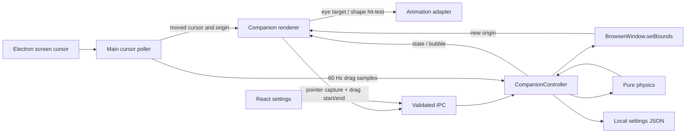

# Ducky architecture (Milestones 1–2)

The main process owns all position, movement, behaviour and persistent state.
The sandboxed renderer presents that state. Pure TypeScript core modules have no
Electron imports and are tested with synthetic clocks, RNGs and display layouts.

## Modules and process boundaries

| Module | Responsibility |
| --- | --- |
| `src/main/index.ts` | Single-instance lock, lifecycle, window/tray wiring, display and resume listeners, clean shutdown |
| `src/main/windows` | Companion/settings creation, navigation and popup denial, session permission/network boundaries |
| `src/main/platform` | Electron display work areas in DIP; cursor poller |
| `src/main/companion/CompanionController.ts` | Authoritative body, active timers, interaction interpretation, event reactions, `setBounds`, speech presentation |
| `src/main/settings` | Validated JSON load, 750 ms debounce, synchronous temp-write/rename, final flush |
| `src/main/ipc` | Named channel allowlist, sender/frame/page checks, strict payload validation, role restrictions |
| `src/main/tray` | Hand-drawn 32 px bitmap converted to PNG, dynamic native menus |
| `src/preload/index.ts` | Typed `window.ducky`, explicit methods and removable subscriptions; no raw IPC or Node exposure |
| `src/renderer/companion` | Adapter host, shape-based hit decisions, pointer capture, bubble presentation |
| `src/renderer/settings` | React controls and live settings; normal focused window |
| `src/core/physics` | Gravity, friction, bounded throws, two-bounce cap, safe display selection, walking and recovery |
| `src/core/behaviour` | Weighted idle/look/sit/walk decisions with injectable clock and RNG |
| `src/core/events` | Typed bus for all section-28 event names |
| `src/core/interruptions` | One visible speech slot, priority/cooldown/mute/block rules, no backlog |
| `src/core/dialogue` | Situation policies, weighted authored pools, last-twelve template exclusion, interaction context |
| `src/animation` | Replaceable adapter contract and self-contained SVG implementation; Rive README only |
| `src/shared` | Settings/IPC types, defaults, channel names and strict validators |
| `src/ai/providers` | Electron-free provider request/interface contracts |
| `src/ai/ollama` | Fixed loopback HTTP transport, schema, deadlines and aborts; instantiated only by main |
| `src/ai/prompts` | Allowlisted context, sanitized app names, same-situation examples and recent dialogue |
| `src/ai/response-validation` | JSON/shape, text, observation, profanity and repetition validation; enum defaults |
| `src/main/ai/HybridBrain.ts` | Model lifecycle, diagnostics, single-request ownership, hybrid routing and stale-result tokens |

## Window and coordinate model

The companion is one 320 × 300 DIP transparent window at size 1.0. The SVG occupies
the whole viewport, with the duck at the bottom and bubble room above. Size scales
both dimensions from 0.6 to 1.6. Physics coordinates are the window's bottom-centre:
`window.x = body.x - width / 2`, `window.y = body.y - height`.
Ground positions are floored to integer DIP. Final window x is rounded and y is
floored, so a fractional work-area floor cannot round the window into the taskbar.
Display scale factors are not applied a second time; Electron screen positions
and work areas already use DIP.

Bounds deliberately reserve space for the **whole window**, which is more
conservative than clamping just the duck's silhouette. Compatible adjacent
same-floor work areas form a walking corridor. Unequal floors cause walking to
turn around. An airborne duck can cross a seam in the displays' vertical overlap;
on reaching unequal ground, the nearest valid display is selected and the window
is fitted there before continuing the fall. This can cause a small positional
correction at a seam. Gaps are never treated as valid floors.

Dragging uses the nearest valid display/corridor and clamps there. Reset uses the
primary work area's bottom-right, with a 24 DIP margin. Startup retains a valid
saved position (falling if airborne), or resets if no display contains it. Display
addition/removal/metrics changes and resume recover to the nearest safe ground.

## Data flow



Cursor polling runs at 20 Hz within 600 DIP of the companion window or for one
second after movement, otherwise at 4 Hz. It sends only changed cursor positions,
preserving the last point across capture mode changes. During a candidate or
active drag, it samples at 60 Hz, including stationary samples to avoid stale
release velocity. Window movement has a separate origin-only notification, so
eyes and hit-tests remain correct even under a stationary cursor.

The renderer uses `document.elementFromPoint` **inside the adapter** against
painted SVG hit shapes, plus the visible bubble in its own HTML. Transparent
regions are not rectangular hitboxes. It sends hit-state changes to main, with
explicit resynchronization after capture/visibility transitions. While capture
is active, main keeps mouse input enabled. Forwarded mouse moves and cursor
updates allow hit-testing even when the window ignores clicks.

On pointer-down, the renderer captures the pointer and main records a grab offset.
Main stops walking immediately, then waits for four DIP of cursor movement before
entering picked-up state. Releases/capture loss/blur terminate the drag once. A
short velocity history feeds physics. Click reactions now run on the next timer
turn (no 500 ms debounce) to meet the instant-reaction target. Native double-click
still opens Settings; its first click may already have spoken.

## Timers and event handling

- Motion: 60 Hz only while falling, sliding or walking. Dragging uses the cursor timer instead.
- Cursor: adaptive 4/20 Hz while visible and unpaused; 60 Hz during capture; stopped otherwise.
- Behaviour: two-second tick while active; decisions are spaced 5–15 seconds apart.
- Idle: 30-second poll while active; threshold defaults to five minutes.
- Blink: one adapter timeout at a random 2–6 second interval, with occasional double blink.
- Breath: four discrete SVG poses spaced 400 ms apart, then eight seconds at rest;
  no ambient CSS animation or transition. Sleep letters stay static. Hide, pause,
  reduced motion and non-ambient poses cancel the breath timeout. Background
  throttling remains enabled; stationary idle has no 60 Hz animation/timer.
- Reactions and speech: bounded one-shot timers. Hide/pause clears them; the adapter stops its timers and CSS animation activity.
- Settings: 750 ms debounce; position changes are saved on release, settle, recovery and quit rather than each frame.

`EventBus` defines every brief section-28 event. M1 emits app start/resume, character
hover/click/pickup/drop/landing, user idle/return, and animation completion. The
controller subscribes to interaction/landing/idle events to drive reactions and
speech. App-awareness situations feed the same director. AI routing happens only
after its chance/cooldown decision and the interruption preflight accept speech.

The speech slot permits higher-priority speech to replace lower-priority speech;
equal/lower priority is rejected. There is no backlog. High priority bypasses
cooldown, but never pause/hide/sleep/top-edge suppression. Sustained dragging starts
a new interaction, interrupting pickup speech/cooldown before the director decides.

## Hybrid AI flow

```text
Interaction / ambient timer / permitted app sample (MAIN)
  -> invalidate older dialogue token
  -> DialogueDirector chance + situation cooldown + curated fallback selection
  -> SpeechQueue preflight (priority, mute, visibility, sleep, screen edge)
  -> rejected/silent: no AI call
  -> instant situation OR AI disabled/warming/error: show curated line immediately
  -> eligible slow situation and warm AI:
       allowlisted context + 4–6 same-situation examples + last 8 spoken beats
       -> MAIN fetch -> http://127.0.0.1:<numeric port>/api/chat
       -> 2.5-second deadline / cancellation / generation + situation recheck
       -> JSON and text validator, repetition against last 20 displayed beats
       -> shouldSpeak:false: silence
       -> invalid/error/timeout: curated fallback (only while still valid)
       -> valid: speech + allowed emotion/animation
       -> SpeechQueue recheck -> renderer bubble text / adapter

Settings -> validated IPC -> MAIN status/tags -> 60-second tiny warmup
  -> Connected / Warming up / Built-in fallback status -> Settings + tray
Test connection -> same serialized main provider -> validated sample in Settings
Pause/hide/sleep/privacy/AI disable -> abort transport + invalidate lifecycle token
New event/app switch/drag release/hover exit -> abort dialogue + invalidate token
```

The model never controls physics, event creation, cooldowns, priority or execution.
The renderer imports no AI transport and the CSP is unchanged. Warmup does not
block the event loop; ordinary events use built-in lines while loading. There is
no polling or automatic retry loop after errors: Test connection, changing the
model/settings, or resuming from suspension reconnects. Model keep-alive is ten
minutes; an unloaded model may hit the warm deadline on a later event and fall
back until reconnected. Optional AI follow-ups for instant reactions are omitted;
authored `then` and validated ambient AI `then` beats use the existing 1.5–2.5 s
replacement timing. Only actually displayed beats enter the bounded RAM history.

## Security boundary

Both renderers use context isolation, disabled Node integration, sandboxing and
web security. The preload builds to a single CommonJS file requiring only Electron.
Only static, validated channels are registered; output channels and unknown names
are not accepted as requests. Invocations verify the exact expected main frame,
webContents and page URL. Companion input methods are unavailable to the settings
renderer at the main-process boundary. Settings patches cannot write position or
the first-launch flag.

Windows block navigation, redirects, popups and webview attachment. The session
denies permissions and downloads. Production requests are limited to local
resources; development additionally permits the configured Vite loopback origin
and its WebSocket. Main's new network client is the fixed-origin Ollama provider;
it rejects redirects and never accepts a host/URL from settings, context or output.
The existing awareness helper runs a fixed authored PowerShell/C# script; model
output never reaches it. CSP denies inline scripts, objects, forms and arbitrary resource origins.
Inline styles are allowed for SVG/CSS adapter properties and React styles.

## Later milestones

| Milestone | Attachment point; not implemented in M1 |
| --- | --- |
| M2: brain | Implemented above; real-model quality and desktop responsiveness pending Claude |
| M3: personality | Add pure emotion/personality state and memory interfaces; extend scheduler weights and dialogue selection through the bus |
| M4: awareness | Add separately permission-gated collectors under `src/awareness`; emit typed events without changing physics/renderers |
| M5: productivity | Add `src/main/database` SQLite repository and `src/main/scheduler` durable reminder service; task/reminder/focus events feed existing interruption rules |
| M6: vision | Add separately authorized selected-window capture under `src/awareness/vision`, transient data and validated AI context; no current capture permission or pipeline |
| M7: art | Replace `PlaceholderDuck` with the Rive implementation of the same adapter/surface contract |
| M8: release | Installer/signing, resource budgets, long-duration testing, crash recovery and security/accessibility review |

Future productivity timers must have their own lifetime: hiding the companion
must not implicitly stop reminders. There is no task database or reminder
scheduler. Opt-in awareness and local AI are implemented.
